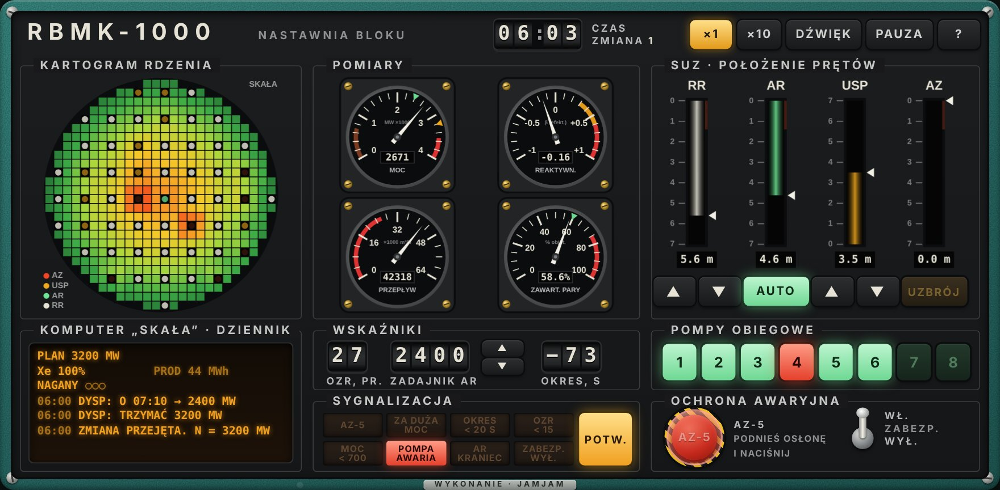
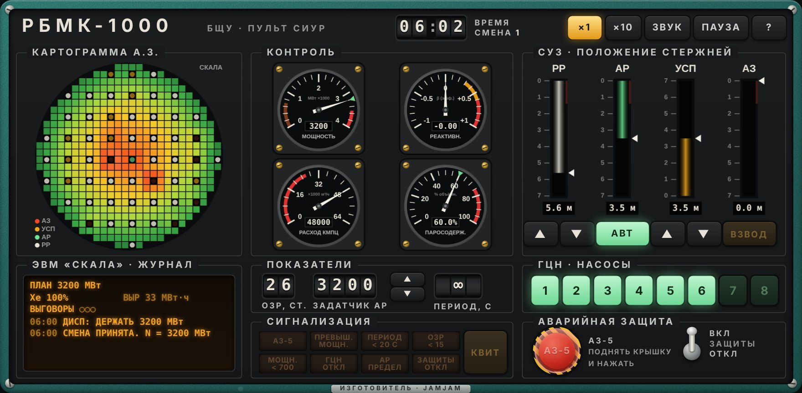
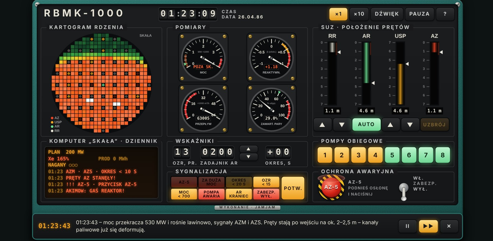
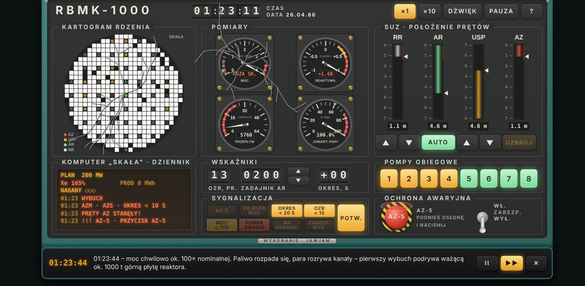

# RBMK-1000 · БЩУ

**A Soviet-style RBMK-1000 reactor control room simulator that runs in the browser — on a phone or a PC.**

**[Polski](#polski) · [English](#english) · [Русский](#русский)** · 📋 **[Changelog / Historia zmian / История изменений](CHANGELOG.md)**

by **JamJam**

| Pulpit (PL) | Пульт (RU) |
|---|---|
|  |  |

| Odtworzenie 26.04.1986 · 01:23:43 | Wybuch · 01:23:44 |
|---|---|
|  |  |

---

## Polski

Symulator blokowej nastawni reaktora RBMK-1000 w klimacie radzieckiej sterowni: turkusowa lakierowana rama, czarne przyrządy z mosiężnymi wkrętami, bębnowe liczniki, podświetlane przyciski i bursztynowy wyświetlacz komputera „SKAŁA”. Całość to jeden plik `index.html` – bez instalacji, działa na telefonie (w poziomie) i na komputerze.

### Jak uruchomić

- **Online:** jeśli w repozytorium włączone są GitHub Pages – otwórz stronę projektu.
- **Lokalnie:** pobierz `index.html` i otwórz go w przeglądarce (Chrome, Edge, Firefox, Safari).
- **Na Androidzie:** otwórz stronę w Chrome → menu ⋮ → „Dodaj do ekranu głównego”, żeby grać na pełnym ekranie.

### Tryby gry

- **Przejmij zmianę** – zwykła zmiana na bloku. Trzymaj moc zgodnie z planem dyspozytora, reaguj na awarie (wypadające pompy, awaria regulatora AR, zacięcie napędu prętów, pilne polecenia), pilnuj regulaminu. 3 nagany = zwolnienie. Zmiana trwa 8 godzin gry.
- **☢ Odtworzenie 26.04.1986** – zapis nocy katastrofy w Czarnobylu krok po kroku, z narracją: od obniżania mocy 25 kwietnia, przez spadek do 30 MW o 00:28, do testu o 01:23:04 i AZ-5 o 01:23:40. Ostatnie sekundy liczy już prawdziwa fizyka gry.
- **☢ Noc testu – zagraj** – grasz operatorem o 01:08. Możesz powtórzyć historię albo ją zmienić i bezpiecznie wyłączyć reaktor.
- **Easter egg** – ukryty. Podpowiedź: AZ-5.

### Pulpit

- **Kartogram rdzenia** – mapa mocy kanałów i położenia prętów w stylu systemu SKAŁA.
- **Przyrządy:** moc, reaktywność (β), przepływ w obiegu, zawartość pary.
- **SUZ – pręty:** RR (ręczne), AR (automatyczny regulator z zadajnikiem), USP (skrócone od dołu), AZ (awaryjne) – wskaźniki położenia w metrach.
- **Pompy obiegowe 1–8**, **AZ-5** pod osłoną, przełącznik zabezpieczeń, **UZBRÓJ** (odbezpieczenie AZ).
- **Sygnalizacja** z potwierdzaniem alarmów, **dziennik** komputera SKAŁA.
- Wskaźniki: zapas reaktywności (OZR), okres reaktora, zegar zmiany, przyspieszenie czasu ×10.
- Dźwięki: buczenie transformatorów, silniki prętów, brzęczyk alarmów, klakson AZ-5.
- Język **polski** (domyślny) lub **rosyjski** – przełącznik w menu.

### Fizyka (uproszczona)

- Kinetyka punktowa z neutronami opóźnionymi i natychmiastowymi (powyżej +1 β – rozbieg).
- Zatrucie **ksenonem-135** i „jama jodowa” po obniżeniu mocy.
- **Dodatni współczynnik parowy** – mniej przepływu lub mała moc = reaktor niestabilny.
- **Efekt końcowy** prętów z grafitowymi wypieraczami – przy niskim OZR wciśnięcie AZ-5 najpierw *zwiększa* moc.
- Efekt Dopplera, uszkodzenia paliwa, automatyczne zabezpieczenia AZM / AZS / przepływ.

Model jest uproszczony na potrzeby gry: przebieg zdarzeń z 1986 roku jest wierny, liczby na przyrządach są przybliżone.

### Sterowanie

| Dotyk / mysz | Klawiatura |
|---|---|
| RR ▲▼ (przytrzymaj) | ↑ / ↓ |
| USP ▲▼ | Page Up / Page Down |
| AR · AUTO | A |
| POTW. (alarmy) | K |
| PAUZA | P / Esc |

---

## English

A browser simulator of the RBMK-1000 unit control room, styled like a Soviet control panel: teal painted frame, black instruments with brass screws, drum counters, illuminated push-buttons and the amber display of the SKALA plant computer. It is a single `index.html` file – no install, works on phones (landscape) and PCs.

### How to run

- **Online:** open the project page if GitHub Pages is enabled for this repository.
- **Locally:** download `index.html` and open it in a browser.
- **Android:** open the page in Chrome → ⋮ menu → “Add to Home screen” for full screen.

### Game modes

- **Take over the shift** – keep thermal power on the grid dispatcher’s plan, handle failures (pump trips, AR regulator fault, jammed rod drive, urgent orders) and follow the regulations. 3 reprimands and you are fired. A shift lasts 8 game hours.
- **☢ Replay 26.04.1986** – the night of the Chernobyl accident step by step with narration (in Polish): from the power reduction on 25 April, the drop to 30 MW at 00:28, to the test at 01:23:04 and AZ-5 at 01:23:40. The final seconds are computed by the game’s physics.
- **☢ Night of the test – play** – you are the reactor operator at 01:08. Repeat history, or change it and shut the reactor down safely.
- **Easter egg** – hidden. Hint: AZ-5.

### Physics (simplified)

Point kinetics with delayed and prompt neutrons, xenon-135 poisoning and the iodine pit, positive void coefficient, the graphite-displacer “positive scram effect”, Doppler feedback, fuel damage and automatic protections. The sequence of events of 1986 is faithful; instrument values are approximate.

Interface language: **Polish** (default) or **Russian** – switch in the menu.

---

## Русский

Симулятор блочного щита управления реактора РБМК-1000 в браузере, оформленный как советский пульт: бирюзовая крашеная рама, чёрные приборы с латунными винтами, барабанные счётчики, светящиеся кнопки и янтарный дисплей ЭВМ «СКАЛА». Один файл `index.html` – без установки, работает на телефоне (горизонтально) и на ПК.

### Режимы

- **Принять смену** – держать мощность по графику диспетчера, реагировать на отказы (отключение ГЦН, отказ АР, заедание привода РР, срочные команды) и соблюдать регламент. 3 выговора – увольнение.
- **☢ Запись 26.04.1986** – ночь аварии на ЧАЭС шаг за шагом (пояснения на польском языке): от снижения мощности 25 апреля и провала до 30 МВт в 00:28 до испытания в 01:23:04 и АЗ-5 в 01:23:40. Последние секунды считает физика игры.
- **☢ Ночь испытания** – вы СИУР в 01:08. Повторите историю – или измените её и заглушите реактор.
- **Пасхалка** – спрятана. Подсказка: АЗ-5.

### Физика (упрощённо)

Точечная кинетика, ксеноновое отравление и йодная яма, положительный паровой коэффициент, концевой эффект стержней с графитовыми вытеснителями, доплеровский эффект, повреждение ТВЭЛ, защиты АЗМ / АЗС / по расходу. Последовательность событий 1986 года передана верно, значения приборов приблизительные.

Язык интерфейса: **польский** (по умолчанию) или **русский** – переключение в меню.

---

© 2026 JamJam. All rights reserved – see [LICENSE.txt](LICENSE.txt).
